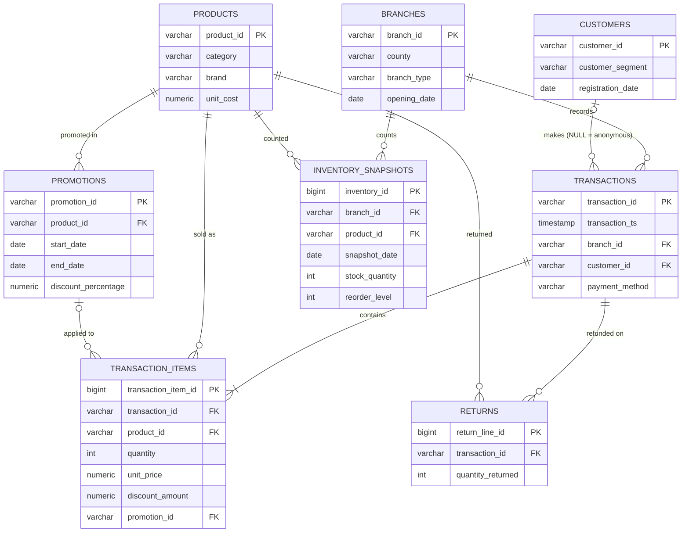
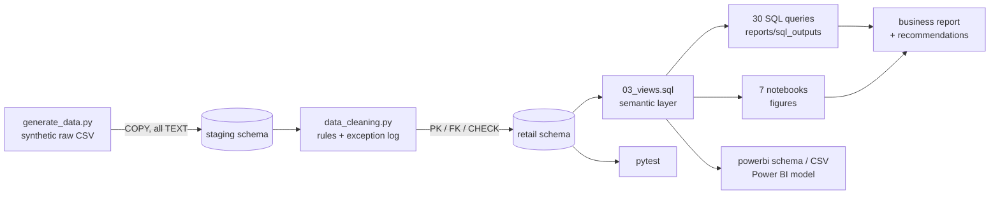
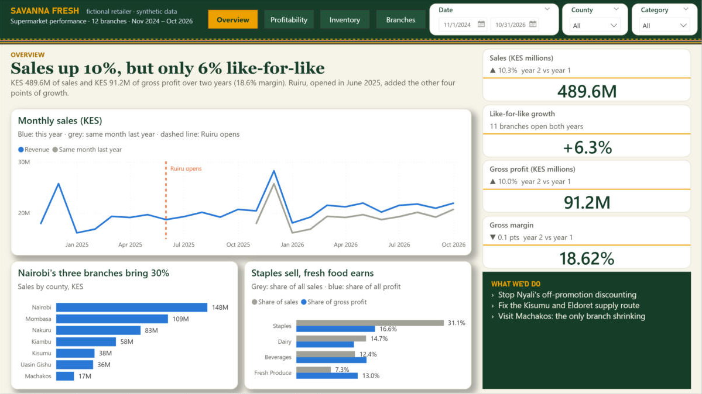
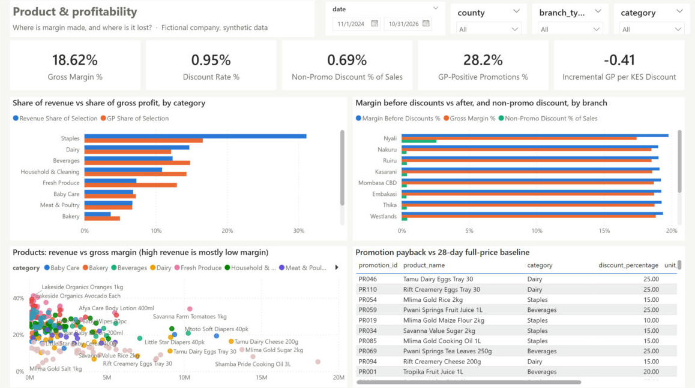
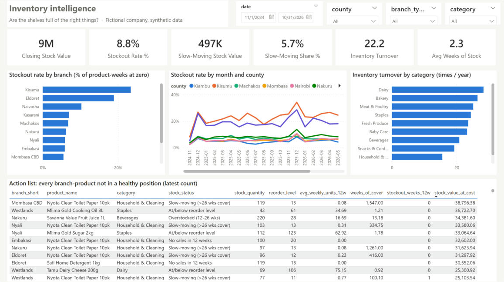
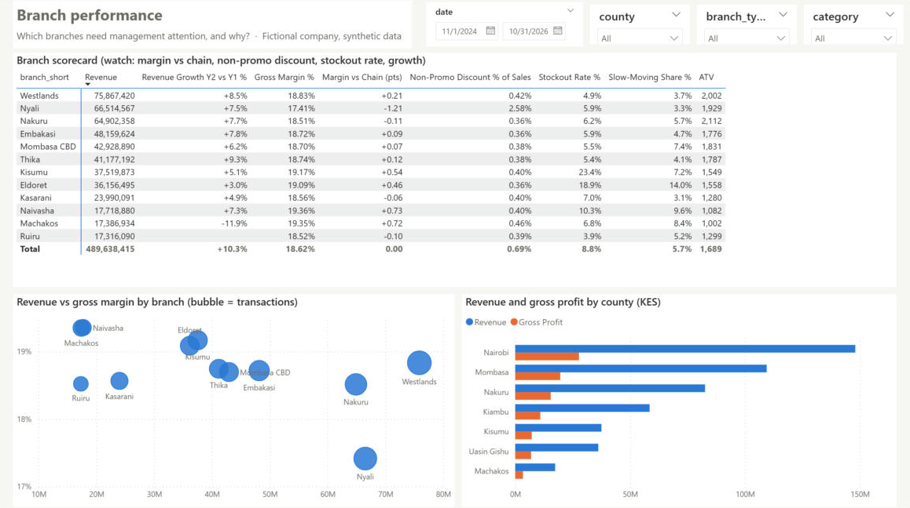
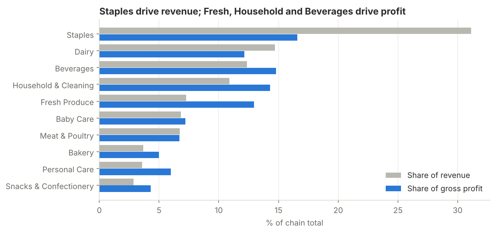
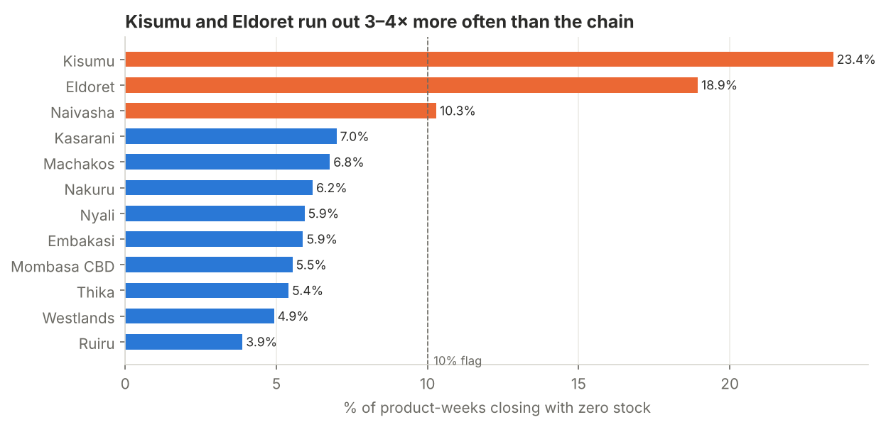

# Kenya Retail Intelligence & Commercial Performance Analytics

An end-to-end commercial analytics project for **Savanna Fresh Supermarkets**, a fictional 12-branch Kenyan supermarket chain. It runs from raw point-of-sale exports to a cleaned PostgreSQL model, 30 SQL analyses, 7 Python notebooks, a Power BI build pack and a management report.

> **Data disclaimer:** every transaction, product, customer and stock record here is **synthetic**, generated by a documented, reproducible script for a fictional company. Brand names are invented. Nothing describes Naivas, Quickmart, Carrefour or any other real retailer. Findings demonstrate analytical method, not facts about a real business.

**Stack:** PostgreSQL 16 · Python (pandas, NumPy, SciPy, Matplotlib, Seaborn, SQLAlchemy) · Jupyter · Power BI / DAX · pytest

---

## 1. Executive summary
Over two years (Nov 2024 – Oct 2026) the chain made **KES 489.6M** of revenue and **KES 91.2M** of gross profit (18.6% margin). Headline growth of 10.3% is **6.3% like-for-like** once a new branch is excluded. The analysis traces management's three concerns to specific causes:

| Concern | What the data shows | Estimated value of fixing it |
|---|---|---|
| Inconsistent branch profitability | Nyali's margin is the lowest of all branches in 23 of 24 months, driven by **non-promotional discounts of 2.6% of sales** (about 0.4% elsewhere), including discounts on non-perishables | about KES 0.75M GP a year |
| Frequent stock shortages | **Kisumu (23%) and Eldoret (19%)** of product-weeks close with empty shelves, against about 5–7% elsewhere, consistent with reorder points that ignore longer lead times | about KES 0.72M GP a year |
| Discounting reducing margins | **74 of 103 promotions** earned less GP than the full-price baseline; **0 of 25** Staples promotions paid back | about KES 0.18M GP a year |
| Slow-moving inventory | KES 0.50M of stock has more than 26 weeks of cover, 77% of it in two Household SKUs whose demand collapsed | about KES 0.38M one-off cash release |

## 2. Business problem
Sales are growing, but the commercial director is concerned about inconsistent branch profitability, slow-moving stock, stock shortages, weak products and discounting. The brief: *find out what is happening, where, and what to do about it.*

## 3. Kenyan industry context
Kenyan supermarkets use staples (maize flour, sugar, cooking oil) as low-margin footfall drivers and earn margin on fresh, household and personal-care lines. Demand follows salary cycles (the 25th to the 3rd) and the December festive season, and up-country branches rely on longer supply routes from Nairobi or Mombasa. Mobile money is the dominant payment method. The simulated business reflects these features.

## 4. Business objectives
1. Measure sales performance by branch, county, category and time, using growth that excludes new stores.
2. Locate profit leakage: product mix vs discounts, and promotion payback.
3. Quantify availability problems and slow-moving stock, and find their root causes.
4. Give management a short, prioritised and measurable action list.

The 22 business questions in the brief are mapped to queries in [`reports/sql_query_guide.md`](reports/sql_query_guide.md).

## 5. Dataset source
I reviewed UCI **Online Retail II** (real, CC BY 4.0, 1.07M lines, UK online gift retailer), Kaggle supermarket samples and KNBS/CBK statistics. None contain branch-level cost, inventory and promotion data for a store-based Kenyan retailer, so I wrote [`src/generate_data.py`](src/generate_data.py) (seed 2027). It produces:

| Table | Rows (clean) | Grain |
|---|---|---|
| branches | 12 | store (7 counties; Hypermarket / Supermarket / Express) |
| products | 203 | SKU (10 categories, fictional brands) |
| customers | 9,000 | loyalty member (4 segments) |
| promotions | 110 | chain-wide product promotion |
| transactions | 289,937 | receipt |
| transaction_items | 1,198,181 | receipt line |
| returns | 2,996 | returned line |
| inventory_snapshots | 249,487 | Sunday closing stock per branch-product (105 weeks) |

Inventory is **simulated from demand** with a reorder-point policy, and sales are capped by available stock, so the two are consistent. Controlled data-quality defects are injected and recorded in a manifest, so that cleaning can be verified.

## 6. Data limitations
Synthetic data (method, not real-world evidence) · weekly closing-stock snapshots miss mid-week stockouts · single standard cost per product (no rebates or shrinkage) · no supplier lead-time field · prices assumed VAT-exclusive · promotion evaluation ignores cannibalisation and halo effects.

## 7. Technology stack
| Layer | Tools |
|---|---|
| Storage & modelling | PostgreSQL 16 (staging + constrained `retail` schema + semantic views) |
| Processing & analysis | Python 3.13, pandas, NumPy, SciPy, SQLAlchemy, psycopg2 |
| Visualisation | Matplotlib, Seaborn, Power BI (DAX) |
| Quality | pytest (39 tests), SQL integrity checks, exception log |

## 8. Database architecture





Design choices: raw data lands in an all-TEXT `staging` schema so bad values can be profiled instead of crashing the load. The `retail` schema enforces keys and business rules (`CHECK (discount_amount <= quantity * unit_price)`, `UNIQUE (product, branch, snapshot_date)`). Returns get their own table, and `transaction_items.promotion_id` makes promotion attribution a join rather than a date-range guess.

## 9. Analytical methodology
Profile → clean (fix only what is certain, quarantine what would be a guess, log everything) → validate → define metrics once in views → analyse with SQL → investigate with Python → communicate. Details: [`reports/methodology.md`](reports/methodology.md).

## 10. SQL analysis
44 named queries in `sql/`, organised by purpose: `02_data_quality_checks`, `04_sales_performance`, `05_profitability`, `06_promotions`, `07_inventory`, `08_management_scorecard`. They use joins, CTEs, subqueries, `CASE WHEN`, conditional aggregation (`FILTER`), window functions (`LAG`, `RANK`, `ROW_NUMBER`, `NTILE`, running and moving totals) and date logic. `python -m src.run_sql` executes everything and saves each result to `reports/sql_outputs/`. Each query's purpose and result are explained in the [SQL query guide](reports/sql_query_guide.md).

## 11. Python analysis
| Notebook | Content |
|---|---|
| [01_data_understanding](notebooks/01_data_understanding.ipynb) | grain, types, coverage, a basket traced end to end |
| [02_data_quality_assessment](notebooks/02_data_quality_assessment.ipynb) | profiling, outlier investigation by segment, rules, manifest cross-check |
| [03_data_cleaning](notebooks/03_data_cleaning.ipynb) | rules applied, value impact, integrity proof |
| [04_exploratory_data_analysis](notebooks/04_exploratory_data_analysis.ipynb) | basket distribution, day × hour heatmap, revenue vs margin |
| [05_sales_and_profitability_analysis](notebooks/05_sales_and_profitability_analysis.ipynb) | LFL growth, category mix, margin bridge, t-test, promotion payback |
| [06_inventory_analysis](notebooks/06_inventory_analysis.ipynb) | turnover, stockouts, reorder root cause, lost GP, slow movers |
| [07_business_insights](notebooks/07_business_insights.ipynb) | scorecards, opportunity sizing, recommendations, optional forecast baseline |

Reusable code is in `src/`: `data_loader.py` (env-var connection, COPY loader), `data_cleaning.py` (rules), `analysis.py` (metric functions, chart style), `pipeline.py`, `run_sql.py`, `export_powerbi.py`.

## 12. Power BI dashboard
Built as a **Power BI project** ([`powerbi/SavannaFresh.pbip`](powerbi/)): the TMDL semantic model and PBIR report are text files, generated by `scripts/build_pbip_model.py` and `scripts/build_pbir_report.py`, then loaded and refreshed in Power BI Desktop. The model is a star schema (2 fact tables, 5 dimensions, a marked date table, 11 single-direction relationships) with 54 DAX measures. A DAX query in Power BI returned exactly the KPI values in `powerbi/kpi_reconciliation.csv`. Model specification, measure definitions and the validation checklist: [`powerbi/README.md`](powerbi/README.md).

Four pages, each answering one question, with shared date, county, branch type and category slicers:






## 13. Key findings (from the analysis)
1. **Growth:** +10.3% headline, **+6.3% like-for-like**; gross profit grew slightly slower than revenue.
2. **Timing:** weekend days +33% vs weekdays (more shoppers, not bigger baskets); paydays +19%; weekday peak 17:00–20:00.
3. **Mix:** Staples are 31% of revenue but 17% of GP (9.9% margin); revenue and margin are negatively correlated across products (Spearman −0.45).
4. **Nyali:** margin before discounts is normal (19.8%), but non-promo discounts are 2.58% of sales vs 0.36–0.46% elsewhere, 1.59% of it on ambient goods.
5. **Promotions:** 74/103 GP-negative; only Snacks & Confectionery returns positive incremental GP per KES of discount.
6. **Availability:** Kisumu 23.4% and Eldoret 18.9% stockout rates; stale reorder levels (below 0.75 weeks of demand) cause 27–55% stockout rates everywhere; about KES 6.0M of GP estimated lost over 2 years, 48% at those two branches.
7. **Stock health:** 5.7% of stock value is slow or unsold; two collapsed Household SKUs explain most of it and the category's −2.6% LFL GP.
8. **Machakos:** the only established branch with declining sales (−11.9% YoY).




## 14. Business recommendations
1. Restrict manual price overrides at Nyali (supervisor approval, reason codes, weekly exception report).
2. Re-set Kisumu and Eldoret reorder points to cover supplier lead time; start with the 30-item watchlist.
3. Run a monthly chain-wide check for stale reorder levels.
4. Move promotional spend toward Snacks & Confectionery and Personal Care; keep Staples and Dairy promotions shallow, budgeted and reviewed.
5. Clear and re-plan the two collapsed Household SKUs, and find out why demand fell.
6. Diagnose Machakos footfall on the ground before any investment decision.

Owners, evidence and success measures: [`reports/recommendations.md`](reports/recommendations.md). Full write-up: [`reports/business_report.md`](reports/business_report.md).

## 15. Limitations
See §6. The most important: findings come from simulated data, and the promotion and lost-sales estimates are screening estimates, not causal measurements.

## 16. Future improvements
- Daily stock positions (or perpetual inventory) to measure mid-week stockouts.
- Test-and-control promotion design, with cannibalisation measured at category level.
- Customer analytics on the loyalty base (RFM, cohort retention). Deliberately left out here, because Project 2 covers customer analytics.
- Scheduled refresh (Airflow or cron) and a Power BI service deployment with row-level security by region.

## 17. What I learned
- **Measure at the right moment.** My first inventory simulation recorded stock *after* deliveries arrived, and the snapshots showed almost no stockouts even though about 5% of demand was being lost. Recording *closing* stock fixed it, and taught me to ask when a snapshot is taken before trusting a stockout rate.
- **Definitions matter as much as calculations.** Margin must be a ratio of totals; ATV needs receipts, not lines; day-of-week averages need a calendar denominator. I moved every definition into SQL views so the notebooks and Power BI cannot drift apart, and wrote a test that reconciles SQL and pandas.
- **Outliers need a question, not a threshold.** A generic z-score rule would have deleted genuine Small Business bulk purchases. Profiling quantity by customer segment separated real bulk buying (up to about 50 units) from ×100 keying errors.
- **A margin gap needs decomposing before it is explained.** Nyali looked like a mix problem until the bridge showed its pre-discount margin was normal.
- **Being honest about synthetic data is part of the work.** Because I designed the mechanisms, I report what the pipeline *recovered and sized*, and I keep the limitations visible.

## 18. Reproduction
Requirements: Python 3.10+, PostgreSQL 14+ (tested on 16).

```bash
git clone https://github.com/M-Linet/kenya-retail-intelligence.git
cd kenya-retail-intelligence
python -m venv .venv && .venv\Scripts\activate        # Windows  (macOS/Linux: source .venv/bin/activate)
pip install -r requirements.txt
copy .env.example .env                                 # then set PGPASSWORD (macOS/Linux: cp)
python scripts/run_all.py                              # about 3 minutes: data → DB → SQL → Power BI extract → notebooks → tests
```
Step by step: `python -m src.generate_data` → `python -m src.pipeline` → `python -m src.run_sql` → `python -m src.export_powerbi` → `python scripts/build_notebooks.py` → `pytest`.

The generated data (about 200 MB of CSV) is git-ignored and rebuilt deterministically from the seed.

---
*Interview preparation for this project: [`reports/interview_questions.md`](reports/interview_questions.md).*
