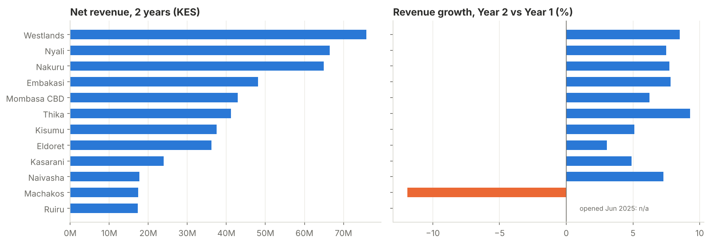
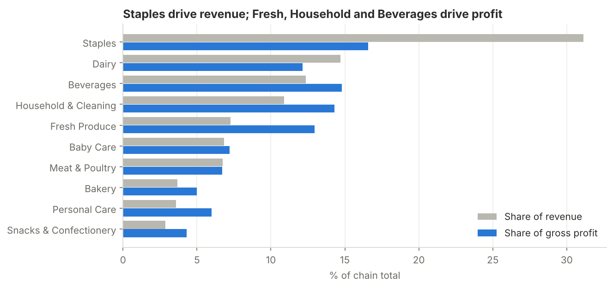
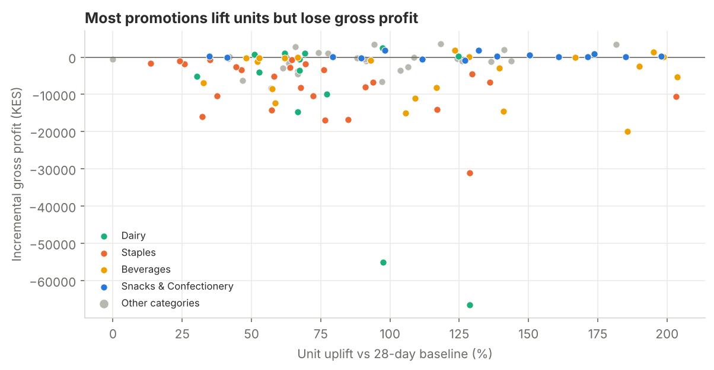
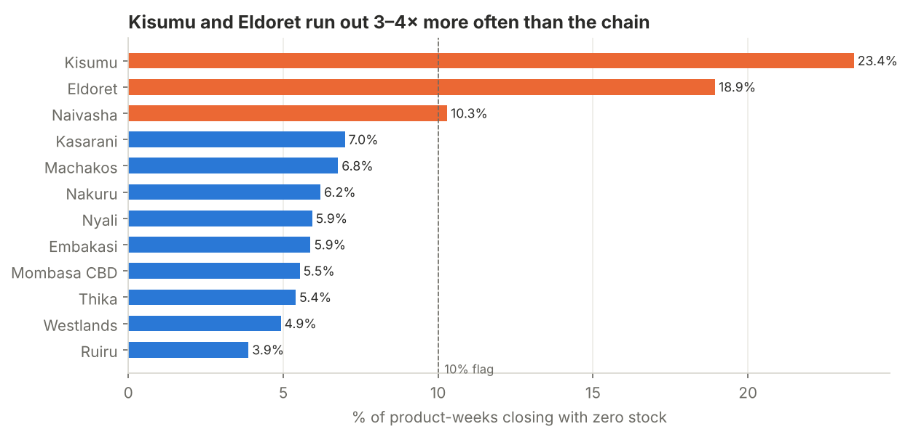

# Savanna Fresh Supermarkets: Commercial Performance Review, Nov 2024 – Oct 2026

**To:** Commercial Director  **From:** Junior Data Analyst  **Date:** November 2026
**Data note:** Savanna Fresh is a fictional chain, and all transaction data is synthetic (see `methodology.md`). The figures are real outputs of the analysis pipeline and illustrate the method; they are not facts about any real business.

---

## Executive summary

The chain generated **KES 489.6M** of net revenue and **KES 91.2M** of gross profit (**18.6% margin**) over two years from 289,936 transactions. Headline revenue grew **10.3%** year-on-year, but **like-for-like growth was 6.3%**. The rest came from opening Ruiru in June 2025. Profit grew slightly slower than revenue.

The concerns behind this review are confirmed, and each one has a specific location:

1. **Margin leakage at Nyali.** Nyali is the #2 branch by revenue but has the lowest margin (17.4% vs 18.6% chain). Its product mix is normal; the gap is **non-promotional discounts of 2.6% of sales**, six times the level elsewhere, including discounts on non-perishable goods that no other branch gives. Nyali had the lowest margin of all twelve branches in 23 of 24 months.
2. **Stock shortages at Kisumu and Eldoret.** 23% and 19% of product-weeks there end with an empty shelf, against about 5–7% in most branches. They account for an estimated **KES 2.9M of the chain's KES 6.0M** of gross profit lost to stockouts.
3. **Discounting that loses money.** **74 of 103 measured promotions earned less gross profit than the same product at full price.** None of the 25 Staples promotions paid back. Only Snacks & Confectionery promotions are clearly profitable.
4. **Slow-moving stock and a declining category.** Household & Cleaning is the only category with falling like-for-like profit (−2.6%), driven by two SKUs whose demand collapsed in January 2026 while stock already on order sat unsold (KES 384K at cost).
5. **One branch in decline.** Machakos is the only established branch whose sales are falling (−11.9% YoY, worse in the latest quarter), even though its margin and availability are normal.

Acting on the first three issues is worth an estimated **KES 1.6M of gross profit a year (3.6% of annual gross profit)**, plus a one-off cash release of about KES 0.5M from slow stock.

## 1. Business context
Kenyan supermarkets compete on price for staples (flour, sugar, cooking oil) to drive footfall, and earn margin on fresh, household and personal-care lines. Payday cycles and the December festive season shape demand, and up-country branches depend on longer supply chains. In that environment, margin discipline and availability matter as much as sales growth.

## 2. Methodology (summary)
Raw POS, product, customer, promotion and weekly stock-count data were loaded into PostgreSQL, cleaned (duplicates, keying errors, returns, invalid dates and orphan records were handled and logged; see `methodology.md`), and analysed with 30 SQL queries (`sql_query_guide.md`) and 7 Python notebooks. Growth is measured year-on-year and like-for-like; margins are calculated from totals; promotions are compared against each product's own 28-day full-price baseline.

## 3. Key findings

### 3.1 Sales performance
| | Year 1 (Nov 24–Oct 25) | Year 2 (Nov 25–Oct 26) | Growth |
|---|---|---|---|
| Revenue, all branches | KES 232.8M | KES 256.9M | +10.3% |
| Revenue, like-for-like | KES 229.0M | KES 243.4M | **+6.3%** |
| Gross profit, like-for-like | | | +6.0% |

- **Where sales come from:** Nairobi 30%, Mombasa 22% and Nakuru 17% of revenue. Westlands is the largest branch (15.5%).
- **When people shop:** Saturday is 33% above an average day, and weekend days average 33% more revenue than weekdays, from more shoppers rather than bigger baskets (ATV is nearly identical). Weekday traffic peaks at 17:00–20:00, and weekends at midday. Days from the 25th to the 3rd sell 19% more than mid-month. December runs about 35–40% above an average month, and January falls back by over a third.
- **Branch growth:** every established branch grew except **Machakos (−11.9%)**. Thika (+9.3%) and Westlands (+8.5%) grew fastest.

### 3.2 Profitability
- **Staples are 31% of revenue but 17% of gross profit** (9.9% margin). Fresh Produce is 7% of revenue and 13% of profit (33% margin). Revenue rank is a poor guide to profit: across products, revenue and margin are negatively correlated (Spearman −0.45).
- **High revenue, low margin:** 29 top-quartile products earn below the chain margin, led by 3L cooking oil (5–11%), sugar, flour, rice and eggs.
- **Nyali's margin gap is discount leakage, not product mix:**

| Branch | Margin before discounts | Non-promo discounts (% of sales) | Gross margin |
|---|---|---|---|
| Nyali | 19.8% | **2.58%** (17.8% of lines) | **17.4%** |
| Other 11 branches | 19.0–19.9% | 0.36–0.46% (about 2.2% of lines) | 18.5–19.4% |

Everywhere else, non-promotional discounts are perishable markdowns. At Nyali, 1.59% of sales is discounts on ambient goods, a pattern consistent with manual till overrides. Excess discounting at Nyali cost about **KES 1.5M over two years** relative to the other branches.

### 3.3 Promotions
| Category | Promotions | Unit uplift | Incremental GP per KES of discount | GP-positive |
|---|---|---|---|---|
| Snacks & Confectionery | 15 | +124% | **+0.15** | 11 |
| Personal Care | 8 | +81% | +0.03 | 4 |
| Beverages | 22 | +104% | −0.34 | 4 |
| Staples | 25 | +76% | **−0.58** | **0** |
| Dairy | 13 | +75% | **−0.59** | 5 |

Promotions reliably increase units, but at low margins the discount given away on units that would have sold anyway exceeds the profit on the extra units. A 15% discount on a product with a 10% margin cannot pay back at any uplift.

### 3.4 Inventory
- **Turnover:** Dairy turns 28 times a year (1.8 weeks of stock), while Personal Care turns 11.6 times (4.5 weeks) and Household & Cleaning 15.6 times (3.3 weeks).
- **Stockouts:** Kisumu 23.4% and Eldoret 18.9% of product-weeks, against 3.9–7.0% for nine of the other ten branches (Naivasha is 10.3%). The rate is high in every month of the period.
- **Two causes:**
  - *Stale reorder levels* (below 0.75 weeks of demand) cause stockouts in 27–55% of weeks in every branch. A few pairs per branch are affected, and they are cheap to fix.
  - *Kisumu and Eldoret* stock out at 17–20% even where reorder levels are set like everywhere else. That pattern indicates their reorder points do not cover a longer delivery lead time. Lead time is not in the data, so this needs confirming with the supply chain team.
- **Slow-moving stock:** KES 0.50M (5.7% of stock at cost) has more than 26 weeks of cover or no sales in 12 weeks. 77% of it is in two Household SKUs (Nyota Clean Toilet Paper 10pk, Safi Home Detergent 1kg) whose sales collapsed in January 2026.

## 4. Business implications
- Growth quality is weaker than the headline: like-for-like sales grew 6.3%, and margin is under pressure in the biggest Coast branch.
- The western branches are losing sales they already have demand for. Customers who find empty shelves may shift their whole basket to a competitor, so the true cost is likely higher than the KES 2.9M estimate.
- The promotion budget currently subsidises customers who would have bought anyway, mostly in the categories where the chain earns least.

## 5. Recommendations
See `recommendations.md` for owners, actions and success measures. In priority order:
1. **Control price overrides at Nyali**: supervisor approval, reason codes and a weekly exception report. *(about KES 0.75M GP a year)*
2. **Re-set reorder points for lead time at Kisumu and Eldoret**, starting with the 30-item watchlist. *(about KES 0.7M GP a year at 50% recovery)*
3. **Run a monthly reorder-level check chain-wide** to catch stale settings (below 0.75 weeks of demand).
4. **Re-direct promotional spend** to Snacks & Confectionery and Personal Care; keep Staples and Dairy promotions only as budgeted footfall drivers, at shallower depth. *(about KES 0.18M GP a year from stopping the losses)*
5. **Clear and re-plan the two collapsed Household SKUs**, and ask the buyer why demand fell. *(about KES 0.38M one-off cash release)*
6. **Investigate Machakos on the ground** before any investment decision: competitors, staffing, local footfall.

## 6. Limitations
- **Synthetic data.** The patterns illustrate the method; magnitudes are not evidence about any real business.
- **Weekly closing-stock snapshots** miss mid-week stockouts that recovered before Sunday, so stockout rates are likely understated.
- **Promotion evaluation** uses a 28-day pre-period baseline and ignores cannibalisation, pantry loading and footfall effects. Confirm with test-and-control promotions.
- **Single standard cost per product.** Cost changes over time, supplier rebates and shrinkage are not modelled, so margins are "front margin" only.
- **No supplier lead-time data.** The lead-time explanation for Kisumu and Eldoret is an inference.
- **VAT treatment.** Prices are assumed VAT-exclusive.

## 7. Conclusion
The business is growing, but the three concerns that prompted this review (inconsistent branch profitability, stock shortages and discounting) are each concentrated in a few identifiable places: one branch's till discounting, two branches' replenishment settings, and promotions in low-margin categories. These problems are operational rather than strategic, and each can be monitored with a metric already built into the dashboard.
